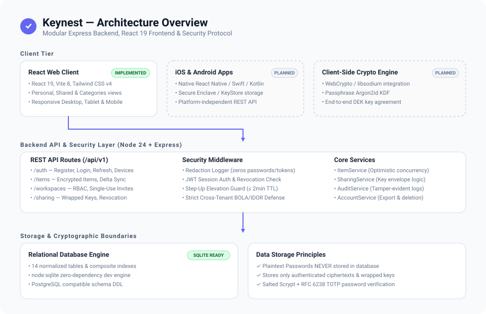
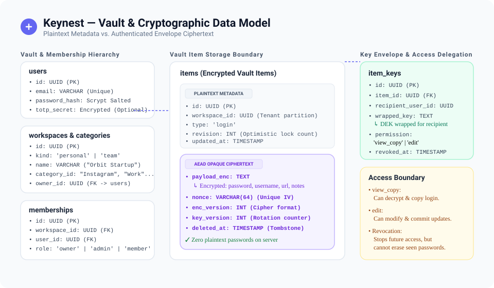
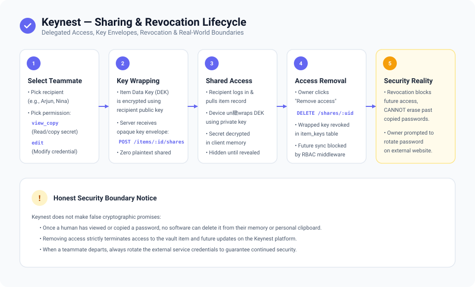

# KeyNest — Personal & Shared Credential Vault

KeyNest is a focused, easy-to-use credential vault designed for personal accounts and startup/community teams. It provides private personal password storage, team password sharing with granular permissions, and custom categories to organize logins.

---

## 1. Architecture Overview



The application consists of a responsive web frontend, a platform-independent modular REST API backend, and an Android client build configuration:

- **Web Frontend (`phase 2/`)**: React 19 + TypeScript + Vite 8.
- **Backend API (`backend/`)**: Node.js 24 + Express 4.21 + Native SQLite engine (`/api/v1`).
- **Android Client (`android/`)**: Jetpack Compose native Android build configuration.

---

## 2. Implemented Features

### Clean First-Time User Experience
- **Zero Demo Records**: No sample credentials, prefilled passwords, demo users, or fake teammates in the shipped application.
- **Sign In & Account Creation**: First screen offers clean email/password sign-in and new account registration with everyday validation.
- **Empty Vault Start**: Every new user starts with an empty vault and a clear primary action: **Add password**.
- **Transparent Security**: Clear notice that zero-knowledge encryption prevents insecure password resets—only the user holds their master vault keys.

### Personal Passwords
- **Private Vault**: A private place for personal logins.
- **Full Credential Lifecycle**: Add, view, edit, delete, search, and copy logins with 1 click.
- **Hidden Passwords**: Passwords remain concealed by default (`••••••••••••`) until explicitly revealed.
- **Clipboard Safety**: Copy button copies password with friendly feedback and 30-second clipboard reminder.

### Shared Passwords
- **Team Logins**: A separate, dedicated section for credentials shared with teammates.
- **Access Delegation**: Share logins with specific teammates and choose permissions:
  - `Can view & copy`: Use the login without editing details.
  - `Can edit`: Update login details and credentials.
- **Dynamic Teammates**: Add teammates by name and email directly when sharing.
- **Access Revocation**: Remove a teammate's access at any time with one click.
- **Access Visibility**: Clearly shows all teammates who have access to each shared login.
- **Real-World Security Notice**: Explicit reminder displayed in the UI:
  > *"Removing access cannot erase a password someone has already seen or copied. If a teammate leaves, change this password on the website to keep the account safe."*

### My Categories
- **User-Defined Categories**: Create, rename, and delete custom categories (e.g., *Work*, *Community*, *Personal*). Categories are user-created and optional.
- **Unified Organization**: Categories apply seamlessly to both personal and shared logins.
- **Category Filtering**: Filter logins by category pills in Personal/Shared views or manage them in the Categories tab.
- **Safe Deletion**: Deleting a category moves associated logins to uncategorized rather than deleting passwords.

### Account & Safety Essentials
- **Lock Vault**: One-click lock button in header/sidebar (`Cmd/Ctrl + L`).
- **Passphrase Unlock**: Clean lock screen to protect vault contents on the device.
- **Sign Out**: Simple sign out control to safely clear active session tokens.

### Hardened Backend REST API
- **Modular Monolith**: Express + TypeScript backend on Node 24 (`/api/v1`).
- **Secret Redaction**: Middleware automatically redacts passwords, tokens, and Authorization headers from logs.
- **Session Authentication**: PBKDF2 password hashing, JWT access tokens, refresh token rotation, and remote device revocation.
- **Step-Up Elevation Guard**: Sensitive operations require recent re-authentication ($\le$ 2 minute TTL).
- **Tenant Isolation**: Server-side authorization preventing cross-user and cross-workspace object access (BOLA/IDOR protection).

---

## 3. Vault & Cryptographic Data Model



The backend schema strictly partitions plaintext operational metadata from sensitive secrets:
- **Plaintext Metadata (visible to backend)**: Workspace IDs, Category IDs, item revision numbers, and timestamps.
- **Encrypted Payload (opaque ciphertext)**: Authenticated ciphertext payload (`payload_enc`), unique IV/nonce, encryption version, and key version.
- **Key Envelopes (`item_keys`)**: Item Data Encryption Keys (DEKs) wrapped per recipient user with explicit permissions (`view_copy` vs `edit`). Plaintext passwords are never stored in the database.

---

## 4. Sharing & Revocation Lifecycle



1. **Selection & Permission**: Owner selects teammate and assigns `view_copy` or `edit` permissions.
2. **Key Envelope Wrapping**: Item DEK is encrypted for the recipient and stored in `item_keys`.
3. **Client Decryption**: Recipient fetches ciphertext and wrapped key, decrypting locally.
4. **Access Revocation**: Owner removes teammate access $\rightarrow$ wrapped key record is revoked $\rightarrow$ future server sync and reads are blocked.
5. **Security Reality**: Revocation cuts off future access, but software cannot erase what a human has previously seen or copied. The app prompts the owner to rotate the external account password.

---

## 5. Prerequisites

- **Node.js**: v20.x or higher (tested on Node v24.x)
- **npm**: v10.x or higher

---

## 6. Setup, Run & Test Instructions

### Quick Launch on Windows (Root Directory)
Double-click `start.bat` in the project root. It will check prerequisites, start both servers in separate windows, and launch `http://localhost:3000` in your browser.

### Backend (REST API)
```bash
# Navigate to backend directory
cd backend

# Install dependencies
npm install

# Run 57 automated tests across 9 suites (100% pass)
npm test

# Run strict TypeScript typecheck
npm run typecheck

# Start development server on http://localhost:4000/api/v1
npm run dev
```

Check API health:
```bash
curl http://localhost:4000/api/v1/health
# Returns: {"status":"healthy","version":"1.0.0",...}
```

### Frontend (Web UI)
```bash
# Navigate to frontend directory
cd "phase 2"

# Install dependencies
npm install --legacy-peer-deps

# Run typecheck lint
npm run lint

# Build for production
npm run build

# Start Vite development server on http://localhost:3000
npm run dev
```

---

## 7. Vercel Web Deployment

The web frontend is pre-configured for deployment on **Vercel**:

### Deployment Steps
1. Import the repository into your Vercel account.
2. Set the build settings:
   - **Framework Preset**: `Vite`
   - **Build Command**: `cd "phase 2" && npm run build` (or `npm run build` if Root Directory is set to `phase 2`)
   - **Output Directory**: `phase 2/dist` (or `dist` if Root Directory is set to `phase 2`)
3. Configure the required environment variable in Vercel Project Settings:
   - `VITE_API_BASE_URL`: URL of your deployed KeyNest backend API (e.g. `https://api.yourdomain.com/api/v1`).
4. Trigger the deployment. SPA routing rewrites are pre-configured in `vercel.json`.

> **Note on Backend Hosting:** The KeyNest backend uses SQLite (`vaultshare.sqlite`). Vercel's serverless functions use an ephemeral read-only filesystem. For persistent data, host the backend API on a persistent service (such as Render, Railway, Fly.io, DigitalOcean, or a VPS), and point `VITE_API_BASE_URL` on Vercel to that service.

---

## 8. Android APK Build Plan

The native Android project is structured in `android/` using Jetpack Compose and AndroidX Security:

- **Application ID**: `com.keynest.vault`
- **Application Name**: `KeyNest`
- **Minimum SDK**: Android 7.0 (API 24)
- **Target SDK**: Android 14 (API 34)

### How to Build the APK
1. **Using Android Studio**:
   - Open the `android/` directory in Android Studio.
   - Sync Gradle dependencies.
   - Select **Build > Build Bundle(s) / APK(s) > Build APK(s)**.
   - Output debug APK: `android/app/build/outputs/apk/debug/app-debug.apk`.
2. **Using Command Line (Gradle)**:
   ```bash
   cd android
   ./gradlew assembleDebug
   ```
3. **Using Cloud CI (GitHub Actions)**:
   - A GitHub Actions workflow is provided at `.github/workflows/android-build.yml`.
   - On push to `main` with Android changes, GitHub Actions automatically compiles the APK using Ubuntu's pre-installed Java 17 and Android SDK.
   - Download the built `app-debug.apk` directly from the GitHub Actions run summary.

### Installation Steps on Device
1. Transfer `app-debug.apk` to your Android device via USB, email, or Google Drive.
2. Enable "Install from unknown sources" in Android Settings if prompted.
3. Open the APK file and tap **Install**.

---

## 9. Security Note

- **No Plaintext Credential Storage**: Passwords and keys are never stored in plaintext on the backend or written to logs.
- **Zero-Knowledge Recovery Boundary**: Because only the user holds their master password, automatic password resets are not supported.
- **Honest Access Boundary**: Revoking access blocks future server reads and sync, but cannot erase credentials already viewed or copied by a recipient.
