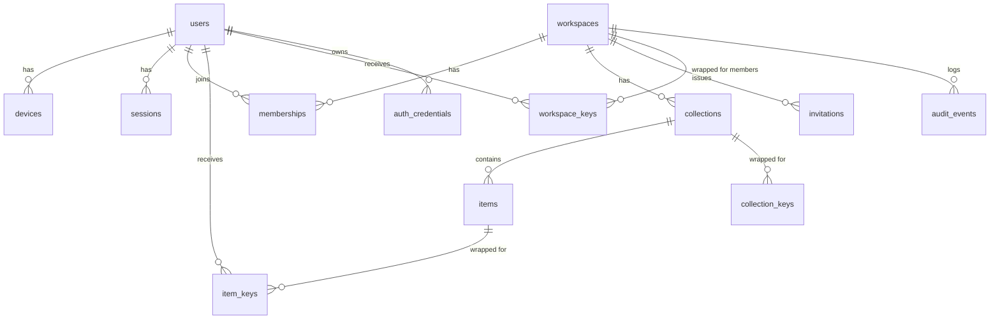

# Backend Schema — VaultShare

PostgreSQL. **Conceptual schema, not final**: the cryptographic protocol (key hierarchy, recovery, metadata encryption) must be finalized by a specialist first. Every field below is classified:

- **P** = plaintext metadata (server-visible)
- **E** = encrypted client-side (opaque `bytea` to server)
- **O** = operational

## 1. ER Overview

## 2. Tables

### users
| Column | Type | Class | Notes |
|---|---|---|---|
| id | uuid PK | O | |
| email | citext unique | P | verified |
| email_verified_at | timestamptz | O | |
| password_hash | text null | O | Argon2id, only if password sign-in used |
| kdf_params | jsonb | O | Salt/params for vault passphrase KDF (client-needed, not secret) |
| key_bundle | bytea | E | Account key wrapped by passphrase-derived key |
| recovery_bundle | bytea null | E | Account key wrapped by recovery key (no server-readable escrow) |
| status | enum(active, locked, deleted) | O | |
| created_at, updated_at | timestamptz | O | |

### auth_credentials
| Column | Type | Class |
|---|---|---|
| id | uuid PK | O |
| user_id | uuid FK | O |
| type | enum(passkey, totp) | O |
| credential_id | bytea | O |
| public_key | bytea | O |
| totp_secret_enc | bytea | O (encrypted with KMS key) |
| sign_count | int | O |
| last_used_at | timestamptz | O |

### devices
| Column | Type | Class | Notes |
|---|---|---|---|
| id | uuid PK | O | |
| user_id | uuid FK | O | |
| name | text | P | |
| identity_public_key | bytea | P | X25519 public |
| enrolled_by_device_id | uuid null | O | approval chain |
| revoked_at | timestamptz null | O | |
| last_seen_at | timestamptz | O | |

### sessions
| Column | Type | Class |
|---|---|---|
| id | uuid PK | O |
| user_id, device_id | uuid FK | O |
| refresh_token_hash | bytea | O |
| expires_at, revoked_at | timestamptz | O |
| ip_hash, user_agent | text | O |
| elevated_until | timestamptz null | O |

`elevated_until` is set only after a **server-verified step-up** (passkey assertion or TOTP re-authentication), never because the vault was unlocked: the vault passphrase is checked on the device only and the server cannot observe it.

### workspaces
| Column | Type | Class | Notes |
|---|---|---|---|
| id | uuid PK | O | |
| name | text | P* | *or encrypted if metadata-private mode chosen |
| kind | enum(personal, team) | O | |
| owner_id | uuid FK users | O | |
| key_version | int | O | increments on rotation |
| created_at, deleted_at | timestamptz | O | |

### memberships
| Column | Type | Class |
|---|---|---|
| id | uuid PK | O |
| workspace_id, user_id | uuid FK | O |
| role | enum(owner, admin, member) | O |
| status | enum(invited, active, suspended, removed) | O |
| joined_at, removed_at | timestamptz | O |
| UNIQUE | (workspace_id, user_id) | |

### invitations
| Column | Type | Class |
|---|---|---|
| id | uuid PK | O |
| workspace_id | uuid FK | O |
| invitee_email | citext | P |
| role | enum | O |
| token_hash | bytea | O (single use) |
| expires_at | timestamptz | O (short-lived) |
| accepted_at, revoked_at | timestamptz | O |
| invited_by | uuid FK | O |

### collections
| Column | Type | Class |
|---|---|---|
| id | uuid PK | O |
| workspace_id | uuid FK | O |
| name_enc | bytea | E (or `name` P if searchable by server) |
| key_version | int | O |
| created_at, deleted_at | timestamptz | O |

### items
| Column | Type | Class | Notes |
|---|---|---|---|
| id | uuid PK | O | |
| workspace_id | uuid FK | O | |
| collection_id | uuid FK null | O | |
| type | enum(login) | P | MVP: login only |
| payload_enc | bytea | E | service, URL, username, password, notes, tags |
| nonce | bytea | O | unique per encryption |
| enc_version | smallint | O | algorithm/format version |
| key_version | int | O | |
| revision | bigint | O | optimistic concurrency, monotonic |
| created_by, updated_by | uuid FK | O | |
| created_at, updated_at, deleted_at | timestamptz | O | tombstone |

AAD bound into AEAD: `item_id | workspace_id | revision | enc_version`.

### workspace_keys (per-member wrapped workspace key)
| Column | Type | Class | Notes |
|---|---|---|---|
| id | uuid PK | O | |
| workspace_id | uuid FK | O | |
| recipient_user_id | uuid FK | O | |
| recipient_device_id | uuid FK null | O | |
| wrapped_key | bytea | E | Workspace key sealed to recipient public key |
| key_version | int | O | matches `workspaces.key_version` |
| granted_by | uuid FK | O | |
| granted_at, revoked_at | timestamptz | O | |
| UNIQUE | (workspace_id, recipient_user_id, recipient_device_id, key_version) | | |

Completes the key hierarchy in `trd.md` (account key → device keypair → workspace key → collection/item key). Rotation creates a new row per remaining member at the new `key_version`; the removed member gets no new row.

### item_keys / collection_keys (wrapped keys)
| Column | Type | Class |
|---|---|---|
| id | uuid PK | O |
| item_id / collection_id | uuid FK | O |
| recipient_user_id | uuid FK | O |
| recipient_device_id | uuid FK null | O |
| wrapped_key | bytea | E (sealed to recipient public key) |
| permission | enum(view_copy, edit) | O (server enforces `edit` for writes only) |
| key_version | int | O |
| granted_by | uuid FK | O |
| granted_at, revoked_at | timestamptz | O |

`view_copy` is advisory for reads: anyone holding the wrapped key can decrypt and copy the item, and the server cannot prevent it. Only write access (`edit`) is server-enforced.

### audit_events
| Column | Type | Class |
|---|---|---|
| id | uuid PK | O |
| workspace_id | uuid FK null | O |
| actor_user_id | uuid FK | O |
| action | text (e.g. `item.share`, `member.remove`) | O |
| target_type, target_id | text, uuid | O |
| outcome | enum(success, denied, error) | O |
| ip_hash | text | O |
| created_at | timestamptz | O |
| **Rule** | no secret values or ciphertext in rows | |

### rotation_tasks
| Column | Type |
|---|---|
| id uuid PK, workspace_id, item_id | uuid |
| triggered_by_event_id | uuid FK audit_events |
| status | enum(open, done, dismissed) |
| created_at, completed_at | timestamptz |

### sync_cursors
| Column | Type |
|---|---|
| device_id uuid PK | |
| last_revision | bigint |
| updated_at | timestamptz |

## 3. Indexes
- `items (workspace_id, updated_at)` and `(workspace_id, revision)` for sync.
- `memberships (user_id, status)`, unique `(workspace_id, user_id)`.
- `item_keys (recipient_user_id, revoked_at)`.
- `workspace_keys (workspace_id, recipient_user_id, key_version)`.
- `audit_events (workspace_id, created_at desc)`.
- `invitations (token_hash)` unique.

## 4. Authorization Rules (service layer, every request)
1. Resolve session → user → device (not revoked).
2. Resolve membership: `status = active` for workspace.
3. Resolve role and per-item/collection grant (`item_keys.revoked_at IS NULL`).
4. Writes require `edit` permission or Admin/Owner; membership/key changes require Admin/Owner and a valid step-up (`sessions.elevated_until > now()`, set by passkey/MFA re-authentication).
5. Deny by default; log denial as audit event.

## 5. Rotation Procedure (conceptual)
1. Mark membership `removed`, revoke sessions/devices for that workspace access.
2. Increment `workspaces.key_version`.
3. Clients of remaining members create new `workspace_keys` rows at the new `key_version`, rewrap keys, re-encrypt affected records, submit with new `key_version`.
4. Old `workspace_keys` and `item_keys` for removed user set `revoked_at`.
5. Create `rotation_tasks` for items the removed member could view.

## 6. Retention and Deletion
| Data | Retention |
|---|---|
| Items (soft deleted) | Purge after 30 days |
| Audit events | 1 year (configurable by workspace) |
| Sessions | Expired purged after 30 days |
| Backups | Encrypted, 35-day rolling; purge on account deletion within window, disclosed |
| Deleted accounts | Hard delete after grace period (7 days) |

## 7. Migration Notes
- Versioned migrations (e.g. `node-pg-migrate`/Prisma Migrate).
- `enc_version` and `key_version` enable algorithm and key migrations without downtime.
- Row-level security (RLS) as defense in depth on `workspace_id`.
