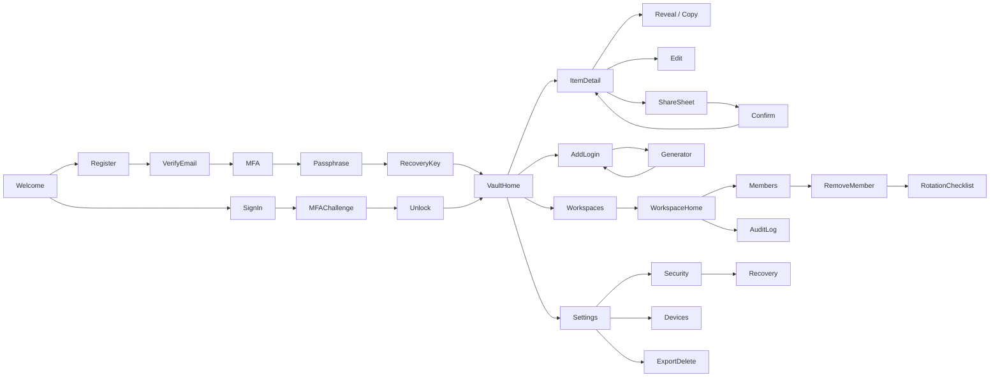

# UI/UX Flow — VaultShare

## 1. UX Principles
1. **Honest security** — say what protections do and don't do, in plain language, at the moment it matters.
2. **Minimum steps for common tasks** — find → copy in ≤ 3 taps after unlock.
3. **Hidden by default** — passwords revealed only on explicit action.
4. **Safe defaults** — conservative auto-lock, minimum permission when sharing.
5. **Friction where risk is high** — re-enter the vault passphrase (local check) before reveal; require a server-verified step-up (passkey or MFA re-authentication) for export, share, member removal, device add, and recovery changes.
6. **No dark patterns** — destructive actions explain consequences and are never one tap.

## 2. Information Architecture
```
App
├── Vault
│   ├── All items / Folders / Tags
│   ├── Item detail / Add-Edit
│   └── Generator
├── Workspaces
│   ├── Workspace home (collections, members)
│   ├── Invitations
│   ├── Sharing and permissions
│   ├── Rotation checklist
│   └── Audit log
└── Settings
    ├── Security (MFA, passkeys, recovery, auto-lock, clipboard)
    ├── Devices and sessions
    ├── Export / Delete account
    └── Help / Security documentation
```

## 3. Navigation
| Platform | Pattern |
|---|---|
| Mobile | Bottom tabs: Vault · Workspaces · Generator · Settings; floating Add button |
| Tablet | Two-pane (list + detail), side rail |
| Desktop | Three-pane: sidebar · list · detail; keyboard shortcuts (`/` search, `Ctrl/Cmd+K` quick find, `Ctrl/Cmd+Shift+C` copy password, `Ctrl/Cmd+L` lock) |

## 4. Screen-to-Screen Flow


## 5. State Model
| State | Definition | UI behavior |
|---|---|---|
| Signed out | No session | Sign-in |
| Signed in, locked | Session valid, keys not in memory | Unlock screen; titles hidden |
| Unlocked | Keys in memory (verified on the device only; the server is not told) | Normal use; auto-lock timer visible in settings; failed passphrase attempts get client-side backoff |
| Elevated | Recent server-verified step-up (passkey or MFA, ≤ 2 min), tracked by the server per session | Sensitive actions (share, remove member, export, device add, recovery change) allowed without re-prompt; independent of vault unlock |
| Revoked/expired | Session or device invalid | Sign-out, wipe local data, explain |
| Offline | No network | Banner; read-only or queued edits |

## 6. Microcopy Guidelines
| Moment | Copy direction |
|---|---|
| Passphrase | "This protects your vault. We can't reset it. Save your recovery key." |
| Share | "People you share with can view this password. Removing them later won't make them forget it." |
| Permission: View/Copy | "They can see and copy this password. We can't stop them from saving it elsewhere. Only Edit is enforced by our servers." |
| Remove member | "We'll block access. To fully protect these accounts, change these passwords." |
| Clipboard | "Copied. Clears in 30 s where your device allows." |
| Screenshot | Never promise blocking; say "Hidden in app switcher where supported." |
| Errors | Specific but never reveal account existence on sign-in/recovery. |

## 7. Feedback and States
| Component | States |
|---|---|
| Item row | default, shared badge, weak/reused warning, offline-pending |
| Password field | hidden, revealed (auto-hides 20 s), copied toast |
| Buttons | default, loading, disabled, destructive |
| Lists | empty (with first-item CTA), loading skeleton, error with retry |
| Sync | synced, syncing, conflict, failed |

## 8. Accessibility
- WCAG 2.2 AA: contrast ≥ 4.5:1, focus visible, touch targets ≥ 44 px.
- Full keyboard navigation; screen-reader labels for reveal/copy controls ("Reveal password for Instagram").
- Do not rely on colour alone for strength or status.
- Respect reduced motion; support dynamic type / 200% zoom.
- Password fields compatible with assistive tech; announce clipboard copy politely.

## 9. Responsive Breakpoints
| Name | Width | Layout |
|---|---|---|
| xs | < 480 | Single column, bottom tabs |
| sm | 480–767 | Single column, larger cards |
| md | 768–1023 | Two-pane |
| lg | ≥ 1024 | Three-pane |

## 10. Onboarding UX Checks
- Progress indicator (5 steps: Account → Verify email → MFA → Passphrase → Recovery key).
- Recovery key must be verified before first save.
- Short explainer card: "What we can't see / what we can't protect against."
- Offer import of fake sample data in beta.

## 11. Usability Test Plan
| Task | Success measure |
|---|---|
| Create account and vault | Complete in < 5 min without help |
| Save and later copy a login | ≤ 3 taps after unlock |
| Share an item with permission | Selects least permission, reads warning |
| Remove teammate | Can explain what rotation is needed |
| Recover from lost passphrase | Uses recovery key successfully |
| Explain revocation limits | ≥ 80% correct in post-test question |
