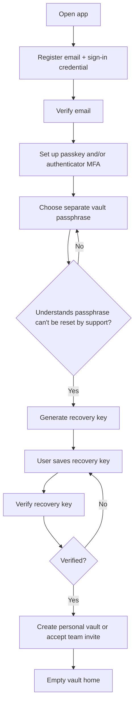
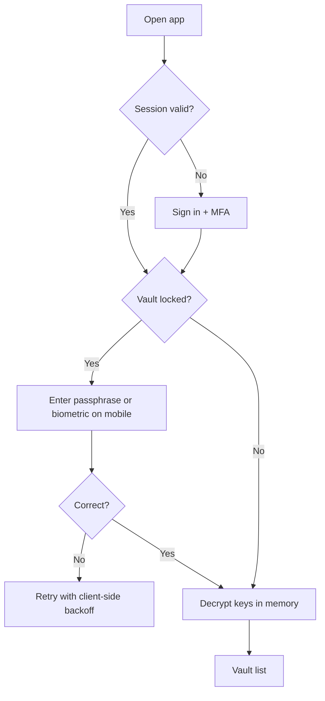
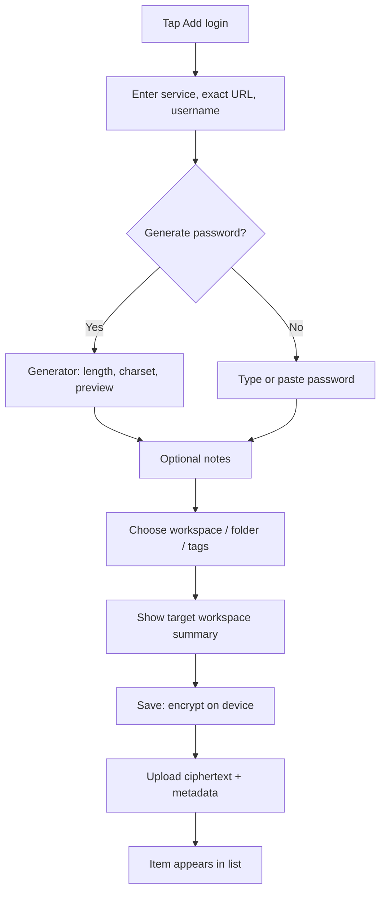
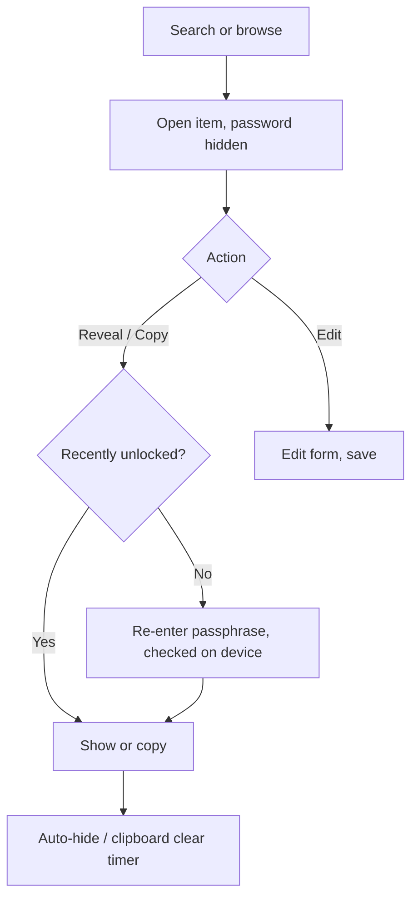
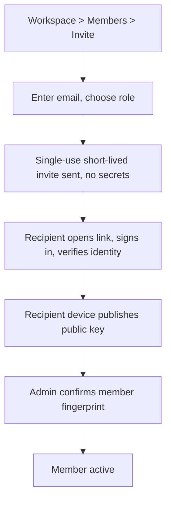
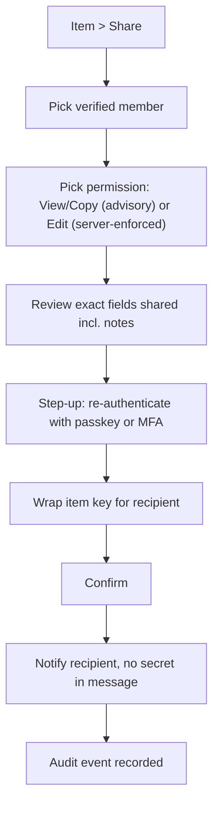
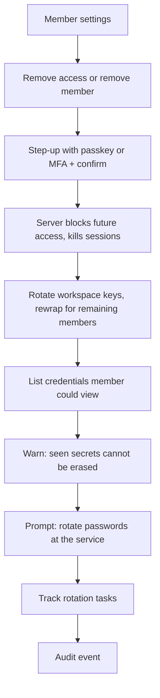
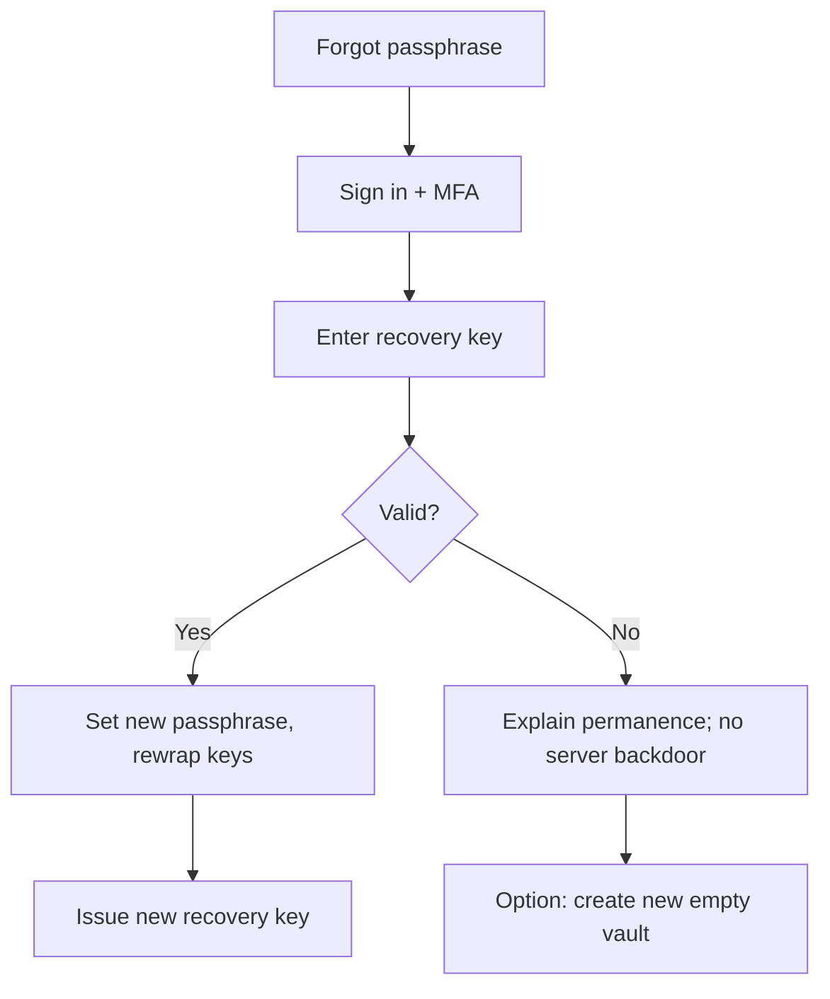
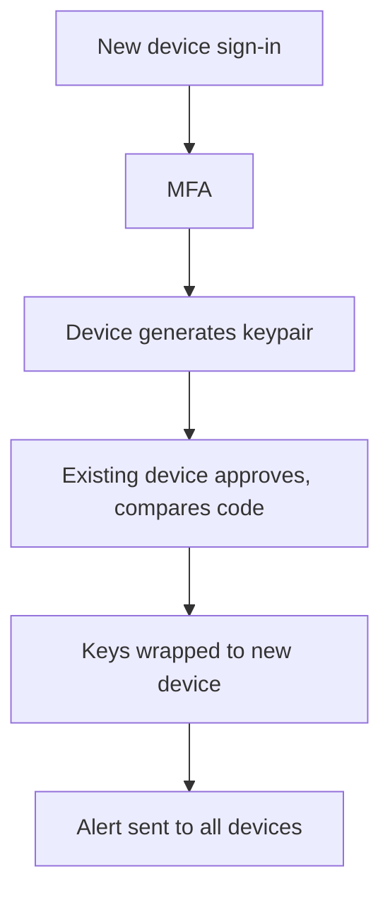
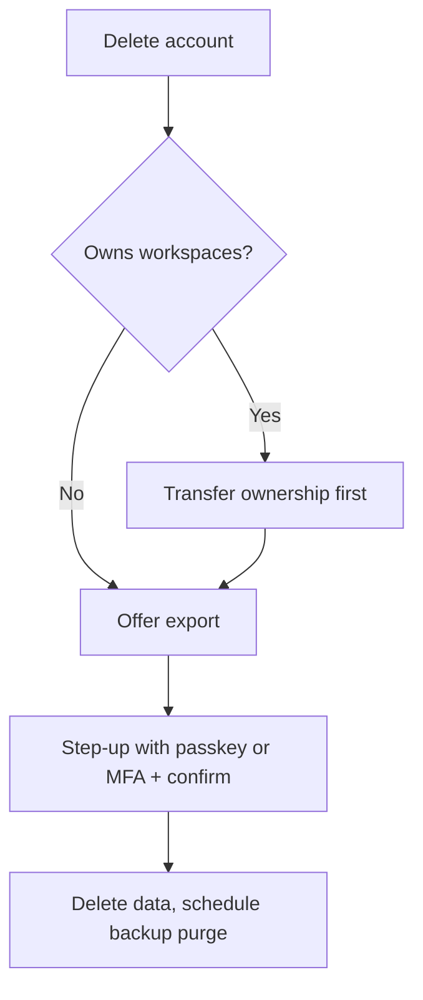

# User Flows — VaultShare

Flows use Mermaid; render in any Markdown viewer that supports it.

## 1. Onboarding: Create account and vault

## 2. Unlock

## 3. Add a login

## 4. Find, reveal, copy

## 5. Invite a teammate to a workspace

## 6. Share an item

## 7. Revoke / remove teammate

## 8. Recovery

## 9. Add a new device

## 10. Offboarding owner and deletion

## 11. Edge cases
| Case | Behavior |
|---|---|
| Offline on mobile | Read cached encrypted data only after unlock; edits queued with revision check |
| Concurrent edit | Conflict prompt with both versions |
| Revoked device | Next request rejected; local data wiped on app open |
| Invite expired/used | Clear error, admin may resend |
| Failed unlock x N | Client-side backoff on the device (the server never sees passphrase attempts); after N failures, lock the session and require full sign-in + MFA again |
| Sensitive action without recent step-up | Server rejects with a step-up-required response; client prompts passkey/MFA, then retries |
