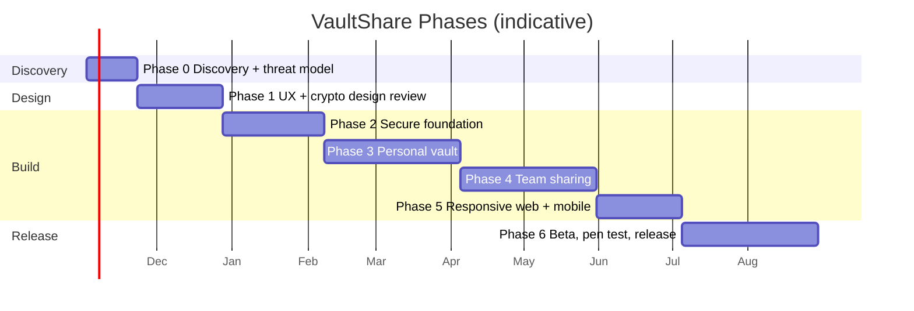

# Workflow — VaultShare Delivery Plan

How the team plans, builds, reviews, and ships. Aligns with the six-phase plan in `prd.md` and `trd.md`.

## 1. Team Roles (small team)
| Role | Responsibility |
|---|---|
| Product owner | Scope, priorities, acceptance |
| System architect / tech lead | Architecture, reviews, release decisions |
| Backend engineer(s) | API, DB, authorization |
| Frontend/mobile engineer(s) | Web + RN clients |
| Cryptography specialist (external or fractional) | Protocol design and review |
| QA / security tester | Test plans, authz matrices, pen-test coordination |
| Designer | UX, design system, usability tests |

## 2. Phase Roadmap

Durations are planning estimates; re-baseline after Phase 1.

## 3. Phase Details
| Phase | Key tasks | Exit criteria |
|---|---|---|
| 0 Discovery | Interviews, threat model, privacy-claim decision, metadata decisions | Agreed scope, abuse cases, threat model |
| 1 UX + crypto | Clickable prototype, protocol spec, field classification | User-tested UX; independent crypto review passed; **no production secrets** |
| 2 Foundation | Auth (passkey/TOTP), sessions, devices, workspaces, RBAC, CI/CD, secrets mgmt, logging redaction | Cross-workspace access tests pass; no secrets in logs |
| 3 Personal vault | `crypto-core`, items CRUD, lock/unlock, search, generator, sync, recovery, export | Independent review: stored data/backups contain no plaintext; device-loss and recovery exercised |
| 4 Team sharing | Invites, memberships, wrapped-key sharing, revoke, rotation, audit, owner transfer | No open critical/high authz or crypto findings |
| 5 Platform readiness | Responsive UI, secure storage on real devices, background lock, clipboard | Core flows pass on supported platforms |
| 6 Beta + release | Private beta (non-critical creds), pen test, restore drills, docs | Release gate met (Section 8) |

## 4. Branching and Commits
- Trunk-based with short-lived feature branches: `feat/…`, `fix/…`, `sec/…`.
- Conventional Commits (`feat:`, `fix:`, `sec:`, `docs:`, `test:`, `chore:`).
- Protected `main`: PR required, 1 reviewer minimum, **2 reviewers + security reviewer for security-sensitive paths** (`crypto-core`, auth, authz, sharing, release pipeline).
- Signed commits and signed release tags.

## 5. Pull Request Checklist
- [ ] Linked issue and brief design note
- [ ] Tests added/updated (unit, authz matrix, E2E where relevant)
- [ ] Lint, typecheck, audit clean
- [ ] No secrets in code/logs/fixtures
- [ ] No crypto outside `crypto-core`
- [ ] No new browser persistence of plaintext
- [ ] Docs and threat-model delta updated
- [ ] UX copy honest (revocation, clipboard, recovery)

## 6. CI/CD Pipeline

```mermaid
flowchart LR
  A[Push / PR] --> B[Install + cache]
  B --> C[Lint + typecheck]
  C --> D[Unit tests + crypto known-answer tests]
  D --> E[Integration + authz matrix]
  E --> F[SAST + dependency audit + secret scan]
  F --> G[Build with locked deps]
  G --> H[E2E on preview env]
  H --> I{Main branch?}
  I -- No --> J[Preview deploy]
  I -- Yes --> K[Sign artifacts + SBOM]
  K --> L[Manual approval, 2 people]
  L --> M[Deploy staging]
  M --> N[Smoke + DAST]
  N --> O[Deploy production, canary]
  O --> P[Monitor + rollback ready]
```

Release pipeline hardening: pinned actions, minimal CI secrets, environment protection rules, SRI/CSP verification step, provenance attestation, no direct production access.

## 7. Environments
| Env | Data | Access |
|---|---|---|
| Local | Fake data | Developers |
| Preview | Fake data, ephemeral | PR authors |
| Staging | Synthetic data | Team |
| Production | Real encrypted data | Limited operators, hardware-key MFA, audited |

## 8. Release Gate (go/no-go)
- [ ] No unresolved critical/high findings (crypto review, pen test)
- [ ] Recovery, restore, key rotation, owner transfer rehearsed
- [ ] Export and account deletion work end to end
- [ ] Privacy/security claims match verified behavior
- [ ] Plain-language security, recovery, and deletion docs published
- [ ] Vulnerability reporting channel live
- [ ] Beta users demonstrate understanding of sharing/recovery consequences
- [ ] Incident response runbook tested (tabletop)

## 9. Security Review Cadence
| When | Activity |
|---|---|
| Every PR | Automated scans + checklist |
| Each phase end | Threat-model update; focused review |
| Before Phase 3 | Crypto protocol independent review |
| Before Phase 6 | Third-party penetration test |
| Quarterly (post-launch) | Dependency review, restore test, access review |

## 10. Incident Response (summary)
1. Detect (alerts, report) → 2. Triage severity → 3. Contain (revoke sessions/keys, disable endpoints, halt releases) → 4. Investigate → 5. Notify affected users and authorities as required → 6. Remediate and rotate operational keys → 7. Post-mortem and doc updates.

## 11. Definition of Ready / Done
**Ready:** user story, acceptance criteria, field classification (P/E/O) for any new data, threat note, designs attached.
**Done:** meets PR checklist, deployed to staging, QA passed, docs updated, monitoring in place.

## 12. Immediate Next Steps (first 2 weeks)
1. Run 8–10 user interviews (individuals, startup teams, community managers).
2. Decide privacy claim, metadata exposure, recovery model, offline stance.
3. Engage a cryptography reviewer; schedule protocol review milestone.
4. Draft threat model workshop and document in `docs/security/`.
5. Build clickable prototype from `wireframe.md` and `uiux-flow.md` with fake data.
6. Set up repo, CI skeleton, secret scanning, and environments.
