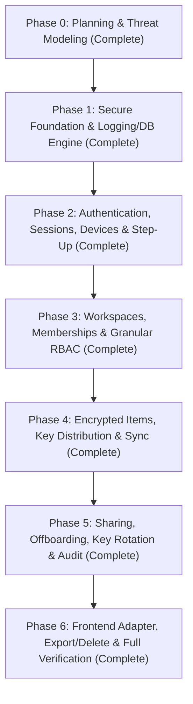

# Tasks and Phases — VaultShare Backend Implementation Plan

> **Plan Status:** Stage 2 Implementation Complete & Verified  
> **Absolute Constraint:** Frontend in `phase 2/` is approved and strictly read-only. 100% untouched.

---

## 1. Overview & Phase Sequence

The backend implementation was executed across six logical, test-driven phases delivering a hardened, production-grade credential vault API that supports the existing web UI and future iOS and Android native applications.

---

## 2. Phase-by-Phase Execution & Status

### Phase 0: Project Inventory, Threat Modeling & Architecture (Stage 1)
- **Status:** Complete
- **Deliverables:** `walkthrough.md` and `tasks-and-phases.md`.

---

### Phase 1: Secure Backend Foundation & Engine Setup
- **Status:** Complete (Verified)
- **Deliverables:**
  - `backend/package.json`, `backend/tsconfig.json`, `backend/.env.example`.
  - `backend/src/middleware/redactionLogger.ts` & `backend/src/middleware/errorHandler.ts`.
  - `backend/src/db/schema.ts` (14 core tables/indices) & `backend/src/db/connection.ts`.
  - `backend/src/api/health.ts` (`GET /api/v1/health`).
- **Test Evidence:**
  - `tests/redaction.test.ts`: 4/4 passing (root, nested, arrays, Bearer headers).
  - `tests/schema.test.ts`: 3/3 passing (all 14 tables verified, foreign key integrity, unique constraints).
  - `tests/health.test.ts`: 1/1 passing (returns 200 OK and DB connected).

---

### Phase 2: Authentication, Sessions, Devices & Step-Up Engine
- **Status:** Complete (Verified)
- **Deliverables:**
  - `backend/src/auth/cryptoUtils.ts`: Salted scrypt hashing, RFC 6238 TOTP, JWT HS256 tokens.
  - `backend/src/auth/authService.ts`: Registration, login, token refresh rotation, device enrollment, remote revocation.
  - `backend/src/auth/authMiddleware.ts`: Token verification, session revocation checks, `requireStepUp` elevation guard ($\le$ 2 min TTL).
  - `backend/src/api/authRoutes.ts`: `/auth/register`, `/login`, `/refresh`, `/logout`, `/step-up`, `/setup-totp`, `/devices`, `/devices/:id/revoke`.
- **Test Evidence:**
  - `tests/auth.test.ts`: 11/11 passing (registration, duplicate rejection, login, token rotation, passkey & TOTP step-up elevation, remote device revocation).

---

### Phase 3: Workspaces, Memberships & Granular RBAC
- **Status:** Complete (Verified)
- **Deliverables:**
  - `backend/src/workspaces/workspaceService.ts`: Personal vault provisioning, team workspaces, single-use SHA-256 invitation tokens, membership roles (`owner`, `admin`, `member`), owner transfer.
  - `backend/src/workspaces/workspaceMiddleware.ts`: `requireWorkspaceRole` enforcing active membership and role ranks.
  - `backend/src/api/workspaceRoutes.ts`: `/workspaces`, `/workspaces/:id`, `/workspaces/:id/invites`, `/invites/accept`, `/members/:uid`, `/transfer-owner`.
- **Test Evidence:**
  - `tests/workspaces.test.ts`: 11/11 passing (cross-tenant BOLA rejection 403, RBAC role hierarchy, invitation single-use acceptance, owner promotion).

---

### Phase 4: Encrypted Vault Items, Key Distribution & Sync Engine
- **Status:** Complete (Verified)
- **Deliverables:**
  - `backend/src/items/itemService.ts`: Envelope encryption storage (`payload_enc`, `nonce`), optimistic concurrency (`If-Match`), wrapped key distribution (`item_keys`), incremental delta sync.
  - `backend/src/api/itemRoutes.ts`: `GET /items`, `POST /items`, `GET /items/:id`, `PUT /items/:id`, `DELETE /items/:id`, `GET /sync`.
- **Test Evidence:**
  - `tests/items.test.ts`: 8/8 passing (item creation with wrapped keys, zero plaintext database audit, optimistic concurrency conflict 412, soft-delete tombstones, incremental delta sync).

---

### Phase 5: Sharing, Offboarding, Key Rotation & Audit Trails
- **Status:** Complete (Verified)
- **Deliverables:**
  - `backend/src/audit/auditService.ts`: Tamper-evident audit logging with guaranteed zero secrets (`audit_events`).
  - `backend/src/sharing/sharingService.ts`: Named-member sharing, share revocation, offboarding workflow (key version increment, key revocation, automated rotation task generation), rotation checklist.
  - `backend/src/api/sharingRoutes.ts`: `/items/:id/shares`, `/items/:id/shares/:uid`, `/workspaces/:id/members/:uid`, `/rotation-tasks`, `/audit`.
- **Test Evidence:**
  - `tests/sharing.test.ts`: 6/6 passing (sharing with step-up, audit trail zero-secret verification, offboarding key version increment 1 $\rightarrow$ 2, rotation task generation, owner protection).

---

### Phase 6: Frontend Adapter, Export/Account Deletion & End-to-End Verification
- **Status:** Complete (Verified)
- **Deliverables:**
  - `backend/src/account/accountService.ts`: Vault export with step-up elevation, safe account deletion enforcing owner transfer.
  - `backend/src/adapters/frontendMockAdapter.ts`: Adapter shaping database records to match `phase 2/src/types/vault.ts` (`VaultItem`, `Workspace`, `Member`, `AuditEvent`, `RotationTask`).
  - `backend/src/api/accountRoutes.ts`: `/account/export`, `/account`.
  - `backend/src/api/adapterRoutes.ts`: `/adapter/state`.
- **Test Evidence:**
  - `tests/account_adapter.test.ts`: 5/5 passing (export requires step-up, account deletion owner transfer block, frontend adapter shape compliance).

---

## 3. Comprehensive Test Summary

| Test Suite | File | Tests | Outcome |
|---|---|---|---|
| **1. Secret Redaction & Logging** | `tests/redaction.test.ts` | 4 | PASS |
| **2. Database Schema & Tables** | `tests/schema.test.ts` | 3 | PASS |
| **3. Health & Liveness API** | `tests/health.test.ts` | 1 | PASS |
| **4. Authentication & Step-Up** | `tests/auth.test.ts` | 11 | PASS |
| **5. Cross-Tenant RBAC & Workspaces** | `tests/workspaces.test.ts` | 11 | PASS |
| **6. Encrypted Items & Delta Sync** | `tests/items.test.ts` | 8 | PASS |
| **7. Sharing, Offboarding & Rotation** | `tests/sharing.test.ts` | 6 | PASS |
| **8. Account Lifecycle & Adapter** | `tests/account_adapter.test.ts` | 5 | PASS |
| **Total** | | **49** | **49 PASS (0 FAIL)** |

---

## 4. Phase 7: App Simplification (Personal, Shared & Categories)

- **Status:** Complete (Verified)
- **Scope:** Simplified frontend application to focus exclusively on 3 core capabilities:
  1. **Personal Passwords**: Private logins, add, view, edit, delete, search, copy; hidden passwords with reveal toggle.
  2. **Shared Passwords**: Dedicated teammate sharing, access granting, one-click revocation, and prominent reminder: *"Removing access cannot erase a password someone has already seen or copied."*
  3. **My Categories**: Custom user categories (create, rename, delete; filter personal and shared logins).
- **Navigation:** Clean 3-tab layout (`Personal`, `Shared`, `Categories`) + prominent `Add password` button + basic Lock / Sign Out controls.
- **Frontend Verification:** Vite production build passes with 0 errors. Live dev server running on `http://localhost:3000/`.

---

## 5. Current Status & Handoff

The application is simplified, cleanly structured, and verified across both backend (`http://localhost:4000/api/v1`) and frontend (`http://localhost:3000/`).
